 

Estudante de **Sistemas de Informação** na Impacta e analista na **Loft**, migrando para desenvolvimento **back-end**. Gosto de pegar uma regra de negócio confusa e transformar em sistema: especifico antes de codar, modelo o banco, testo e documento. Já entreguei **dois sistemas completos**, publicados e com documentação.

📍 São Paulo · 🎯 Buscando **estágio** ou vaga **júnior** em desenvolvimento · [Portfólio](https://leonardo-sferreira.github.io/portfolio/) · [LinkedIn](https://www.linkedin.com/in/ferreirasantosleonardo/) · [E-mail](mailto:leonardoferreira0409@gmail.com)

## Projetos

<table>
  <tr>
    <td width="50%" valign="top">
      
      <h3><a href="https://github.com/leonardo-sferreira/conectahr">ConectaRH</a></h3>
      
Plataforma de RH que tira ponto, férias, documentos e desligamento das planilhas e do e-mail, com quatro perfis de acesso, regras trabalhistas por tipo de contrato e auditoria de cada decisão.

      
✅ Publicado · <code>55 telas</code> <code>316 endpoints</code> <code>80 tabelas</code> <code>52 checks no CI</code>

      
Streamlit · Xano · Supabase · Brevo · OpenSpec

      
<a href="https://conectahr-wtdxtqbzz4lyrpjv8a48nt.streamlit.app/"><b>Abrir o app</b></a> · <a href="https://leonardo-sferreira.github.io/conectahr/">Documentação</a> · <a href="https://github.com/leonardo-sferreira/conectahr">Código</a>

    </td>
    <td width="50%" valign="top">
      
      <h3><a href="https://github.com/leonardo-sferreira/ps-fila-prioritaria">PS Fila Prioritária</a></h3>
      
Fila de pronto-socorro que chama primeiro quem está pior, não quem chegou antes. Fui o <b>Product Owner</b>: defini as regras clínicas, prototipei as telas, modelei o banco e validei as entregas.

      
✅ Entregue e validado · <code>33 telas</code> <code>71 endpoints</code> <code>23 tabelas</code> <code>486 testes</code>

      
Reflex · Xano · pytest · Brevo · OpenSpec

      
<a href="https://leonardo-sferreira.github.io/ps-fila-prioritaria/"><b>Documentação</b></a> · <a href="https://github.com/leonardo-sferreira/ps-fila-prioritaria">Código</a>

    </td>
  </tr>
</table>

**Outros projetos**

- **[Sabor Local](https://github.com/leonardo-sferreira/SaborLocal-Figma)**: delivery de comida mineira desenhado no Figma nos dois lados da operação, com o app do cliente (cerca de 75 telas) e o painel do restaurante (22 telas). [Protótipo no Figma](https://www.figma.com/design/iRn8igu0iCwyqYTathrz9P/Sabor-local?node-id=0-1)
- **Bot de Finanças** (privado): bot do Telegram que transforma `45,90 almoço` num lançamento no Notion, avisa contas que vencem e fecha o mês sozinho. Python, Telegram Bot API e Notion API.
- **[Portfólio](https://github.com/leonardo-sferreira/portfolio)**: meu site, em HTML, CSS e JavaScript puro, publicado no GitHub Pages. [Ver no ar](https://leonardo-sferreira.github.io/portfolio/)

## Destaques

- 🚀 **2 sistemas completos no ar**, somando 88 telas, 387 endpoints e 103 tabelas, com manual do usuário e documentação técnica.
- 🧭 **Product Owner** do PS Fila Prioritária, da regra clínica até a validação das entregas.
- 🧪 **Qualidade desde o início**: especificação no OpenSpec antes do código, testes automatizados e CI a cada Pull Request.
- 🔐 **Segurança e LGPD** na prática: login com código por e-mail, perfis de acesso, auditoria e exportação de dados pessoais.

## Experiência e formação

- **Analista de Atendimento · Loft**: atendimento ao cliente e projetos internos técnicos, como a melhoria do bot de atendimento.
- **Sistemas de Informação · Faculdade Impacta** (em andamento)

## Tecnologias

- **Back-end:** Python · Xano (XanoScript) · APIs REST · PostgreSQL · Supabase · pytest
- **Front-end:** Streamlit · Reflex · HTML · CSS · JavaScript
- **Automação e integrações:** n8n · Make · Salesforce · Telegram Bot API · Notion API · Brevo
- **Design:** Figma · FlutterFlow
- **Práticas:** Git e GitHub · GitHub Actions · OpenSpec · documentação de regras de negócio

## Atividade recente

<!-- atividade:inicio -->
| Repositório | Último commit | Quando |
| --- | --- | --- |
| [**portfolio**](https://github.com/leonardo-sferreira/portfolio) | [Prévia: projetos em destaque e cases nos 5 critérios](https://github.com/leonardo-sferreira/portfolio/commit/b0c80dd90b771c041121b4981f6fe082bb4a89dd) | 24 nov 2026 |
| [**conectahr**](https://github.com/leonardo-sferreira/conectahr) | [Remove a opção Vagas internas do menu](https://github.com/leonardo-sferreira/conectahr/commit/ad937842e49264d33a2f03b2dd12a27b80fd63ac) | 24 nov 2026 |
| [**SaborLocal-Figma**](https://github.com/leonardo-sferreira/SaborLocal-Figma) | [Add Figma screens for client and restaurant apps, rewrite README](https://github.com/leonardo-sferreira/SaborLocal-Figma/commit/c5e80efd273e310d1b1f2c9f44dbd731edbcba61) | 23 nov 2026 |
| [**ps-fila-prioritaria**](https://github.com/leonardo-sferreira/ps-fila-prioritaria) | [docs: README completo no formato de portfólio, com prints das telas](https://github.com/leonardo-sferreira/ps-fila-prioritaria/commit/2498be12ae459c1c03aa52b193aa66a1cf7aa580) | 23 nov 2026 |
<!-- atividade:fim -->

Atualizado todo dia por uma [GitHub Action](.github/workflows/atividade.yml).
